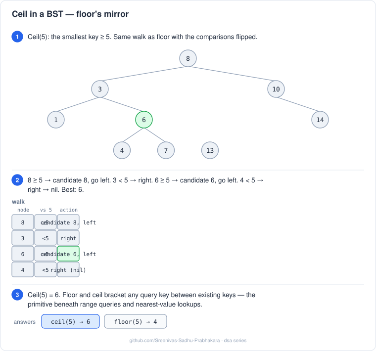

# Ceil in a BST

> Striver SDE Sheet 139 · Day 21 BST II — the floor descent mirrored: larger nodes are candidates before moving left. Go, stdlib only, tested.

## Problem

The ceiling of a key in a BST: the smallest stored value ≥ the key, reporting absence when the key exceeds the whole tree.

## Approach

Floor's mirror image, included by the sheet precisely so you internalize the symmetry rather than memorize two routines. A node above the key is a candidate ceiling, but a tighter one can only live in its *left* subtree — record and descend left. A node below the key steers right without recording. Equal is an immediate exact answer. Floor and ceil together are the BST's version of `sort.SearchInts` bracketing — and they're the primitive behind range queries and nearest-neighbor lookups on ordered trees.

**Complexity:** O(h) time, O(1) space.

## Visual walkthrough

Read the picture top to bottom — each numbered frame is one moment of the algorithm
running on this repo's test example.

## Run

    go test ./...   # verify
    go run .        # demo

---

One of 191 repos solving Striver's SDE Sheet in Go — stdlib only, one problem per repo, every solution tested. Browse the set: [`dsa-*` repos](https://github.com/Sreenivas-Sadhu-Prabhakara?tab=repositories&q=dsa-&type=source).
